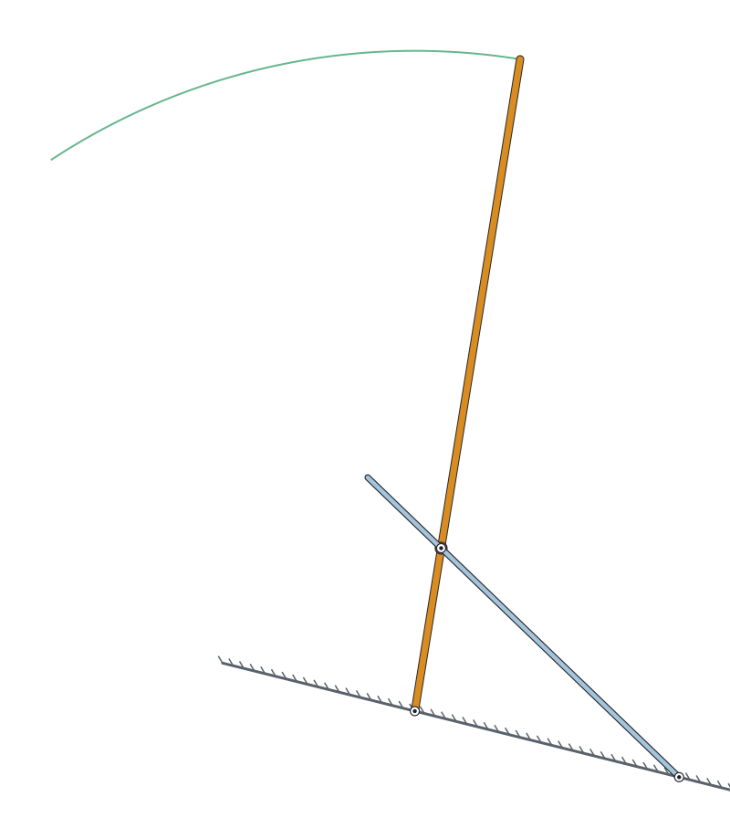
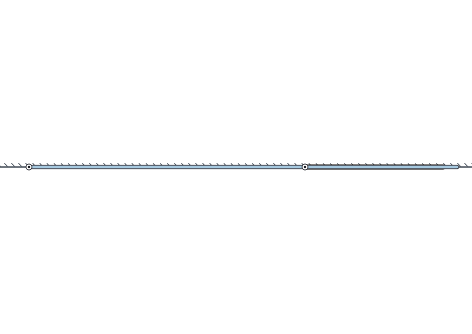
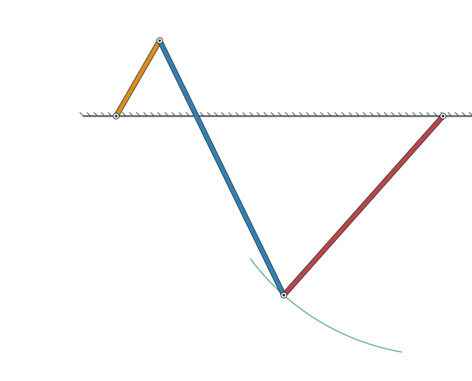
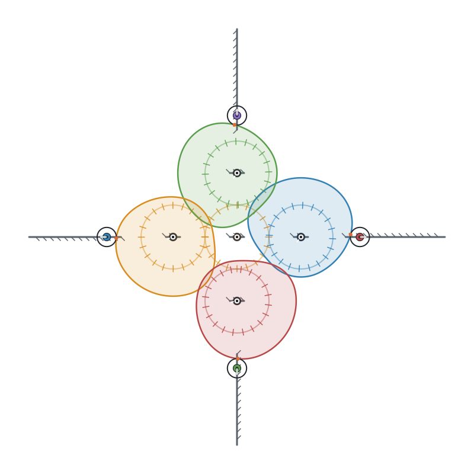

# mech

A small declarative language for planar mechanisms. You describe bodies,
joints and forces; the solver decides everything else — nothing is assigned
causally, so the same file can describe a wiper (drive the crank) or a clock
(drive the weight).

```
mechanism fourbar {
  ground base {
    anchor p1 at (0, 0)
    anchor p2 at (3, 0)
  }
  rod crank   { length: 0.8 }
  rod coupler { length: 2.6 }
  rod rocker  { length: 2.2 }

  pin crank.A   -> base.p1
  pin coupler.A -> crank.B
  pin rocker.A  -> base.p2
  pin coupler.B -> rocker.B

  drive crank at 36 deg/s from 60 deg
}
```

A closed kinematic loop like this is something tree-based formats
(URDF/SDF) cannot express.

## Build and run

Plain C++17, no dependencies. GLFW is optional (for the window).

```bash
make            # builds ./mech (headless-only if GLFW is missing)
make test       # unit tests
```

```bash
./mech check examples/fourbar.mech                 # parse, DOF analysis, initial assembly
./mech run   examples/fourbar.mech --headless 5    # simulate without a window
./mech run   examples/fourbar.mech --trace coupler.B   # needs GLFW: draw the coupler curve
```

## What it can express

| | |
|---|---|
| bodies | `ground`, `rod`, `shaft`, `body` |
| joints | `pin` (revolute), `slide` (prismatic) |
| gears | `gear`, `mesh` (external, internal, epicyclic) |
| contact | `profile` (circle, polar table, point list), `touch` — cams with translating or swinging followers, optional roller |
| teeth and corners | `polygon` profiles — straight edges with filleted corners, exact (no spline ringing) — a ratchet wheel and pawl that clicks forward and locks in reverse |
| friction | `touch ... friction mu` — Coulomb friction at contacts, stable on light bodies, with its dissipation in the energy ledger; a locked ratchet comes to rest |
| non-circular gears | `mesh` between two profiles (circle, polar table, `ellipse`) on fixed shafts — elliptical gear pairs whose output surges; the pair's conjugacy is checked at build time |
| cams | `cam` — state the motion (`rise`, `dwell`, `return`; cycloidal, harmonic, modified-trapezoid) and the compiler cuts the surface; `check` reports pressure angle and rejects undercut |
| forces | gravity, `spring`, torque and weight `drive`s |
| hybrid | `mode` state machines (the escapement) |
| intent | `reduce`, `beat`, `hand`, `dial` — solved into the kernel |

Contact is bilateral in a kinematic file (force closure assumed) and unilateral
in a dynamic one: a spring-loaded cam follower holds the cam at low speed, and
at high speed lifts off, flies and lands with a Newton impact, with every joule
accounted for (`examples/jumpcam.mech`).

Kinematic files are solved with an analytic-Jacobian Levenberg–Marquardt
assembly; files with masses and forces are integrated as constrained
dynamics, with an energy ledger that has to close.

## Measuring a run

`--csv` exports a whole run as a table — every body's pose, contact gap and force,
and (for dynamic files) velocities, energies and every term of the energy ledger — so
you can plot or check it rather than just watch it:

```bash
mech run examples/jumpcam.mech --headless 1 --csv jump.csv
python3 scripts/summarize_run.py jump.csv 'follower.tip@lobe.N[N]'
```

See [`docs/EXPORT.md`](docs/EXPORT.md) for the columns and recipes.

## Parameters and sweeps

Numbers can be named, computed and overridden, and a design swept over a grid:

```bash
mech run   examples/jumpcam.mech --headless 1 --set speed=300
mech sweep examples/jumpcam.mech --set speed=300:700:100 --time 0.15 --report liftoffs
mech sweep examples/platecam.mech --set rise_deg=100,60,30,20,10 --time 2 --report max:follower.y
```

Designs the compiler rejects (an undercut cam, say) are reported in their own row.
See [`docs/PARAMS.md`](docs/PARAMS.md).

## Parts

Write an assembly once, use it many times with different numbers:

```
part plate_cam(lift = 0.012, base_r = 0.025) { ground frame { ... }  cam lobe ...  body follower ... }

mechanism twincam {
  ground bench { anchor origin at (0, 0) }
  use plate_cam(lift = 0.020) as left  on bench at (0, 0)
  use plate_cam               as right on bench at (0.2, 0)
}
```

Everything inside is reached by the instance's name (`left.follower.tip`, `--set left.lift=0.03`,
`--report max:left.follower.y`), and an instanced file runs bit for bit like the flat one.
See [`docs/PARTS.md`](docs/PARTS.md).

## Joints and actuators

A `slide` runs between any two bodies (not only on the ground), a `slot` keeps a pin on a line fixed in another
moving part, and a slide can be driven by a rate or a force:

```
slot crank.B -> yoke.slot                       // a Scotch yoke
slide piston.guide -> cyl.axis                  // a hydraulic cylinder: both parts move
drive piston.guide at 0.02 m/s from 0.50 m      // extend it at 20 mm/s ...
drive piston.guide force 500                    // ... or push with 500 N
```




`mech run --headless --csv` reports the force each actuator delivers, which is the number for sizing a cylinder. A
free `body` can say where its mass is (`com: (0.5, 0)`). Every example here is checked against a closed form (the
yoke is exactly r cos θ; a bead in a rotating tube follows r₀ cosh ωt). See [`docs/JOINTS.md`](docs/JOINTS.md).

## Sizing: what a design has to carry

`mech report FILE --time T` runs a dynamic mechanism and tabulates the peak, RMS and mean of every load: each drive's torque, speed
and power (the motor's peak and continuous rating), each pin's radial force (the bearing's load), each slide's side load and
moment, springs, contacts, racks and belts. The numbers are the solver's constraint multipliers, checked against closed
forms (a bead in a spinning tube, an offset mass under gravity). `--csv` writes them. See [`docs/REPORT.md`](docs/REPORT.md).

## Speed

`mech sweep` runs its rows on all cores (`--jobs N` to choose), and large or contact-heavy mechanisms run several times
faster than before with identical output; `sh scripts/bench.sh` measures it. See [`docs/PERFORMANCE.md`](docs/PERFORMANCE.md).

## A Geneva drive

`lib/geneva.mech` is a complete external Geneva drive made of ordinary unilateral contacts: a pin entering the slots of an N-slot
wheel, and a locking disc that holds it between turns. `use geneva(N = 4) as gv`, drive `gv.crank`, and the wheel advances
`360/N` degrees per turn, exactly the closed form `atan2(r sin c, a + r cos c) − π/N` while the pin is in the slot. See
[`docs/GENEVA.md`](docs/GENEVA.md).

## Rack and pinion, belts and chains

```
mesh pinion on rack.G            // a pinion rolling on the line through the rack's anchor
belt strap ga -> gb -> gc reverse gc   // a belt over three pulleys, the last one crossed
```

Both are rolling relations like a gear mesh: the rack advances `r θ`, a belt makes every rim move alike so the output turns
at `r_in / r_out`. `mech run --csv` reports the force at the rack and across each belt link; a disc rolling down a toothed
incline accelerates at exactly `g sin a / (1 + I/(m r²))`. See [`docs/RACKBELT.md`](docs/RACKBELT.md).

## Drawings

`mech render` draws a pose, or a looping animation, as an SVG: no window, no OpenGL.

```bash
mech render examples/camstar.mech --at 0.4 -o camstar.svg
mech render examples/fourbar.mech --frames 48 --span 10 --trace coupler.B -o fourbar.svg
```




Everything in the file is in world coordinates, so a drawing can be checked against the solver. See
[`docs/RENDER.md`](docs/RENDER.md); the images here are generated by `scripts/make_gallery.sh`.

## The live viewer

`mech run file.mech` animates the mechanism in an OpenGL window (it needs GLFW). It draws the same scene as `mech render`, so
everything above (slides on moving bodies, slots, chains, ring gears, cams) is in the window as well. Offscreen screenshots of
the viewer, taken through a software rasterizer, are in [`docs/img/viewer/`](docs/img/viewer/) and are regenerated by
`scripts/viewer_shots.sh`; [`docs/VIEWER.md`](docs/VIEWER.md) says what that does and does not prove.

## Loops

The count of things can be a number: `for i = 0 to n - 1 { ... }`, with `cam[i]` naming `cam_<i>`, and loops
also work inside anchor lists and `polygon:` lists, so outlines can be computed.

```
for i = 0 to n - 1 {
  use plate_cam as cam[i] on bench at (dist * cos(i * span * pi / 180), dist * sin(i * span * pi / 180)) rotate i * span - 90 deg
}
```

`mech run examples/camstar.mech --set n=6` is six cams around a hub; `--set r.teeth=16` is a 16-tooth ratchet.
See [`docs/PARTS.md`](docs/PARTS.md), section 7.

## Standard parts

`lib/` has five parts, each checked against its closed form: `plate_cam`, `crank_slider`,
`four_bar`, `gear_pair` and `ratchet`.

```
import "../lib/plate_cam.mech"
...
use plate_cam(lift = 0.02) as c on bench at (0, 0)
```

Mounts can be rotated: `use plate_cam as east on bench at (0.04, 0) rotate -90 deg` turns the part about its
mount point, so a library part written upright can point any way.

See [`docs/LIB.md`](docs/LIB.md); `import` and rotation are in [`docs/PARTS.md`](docs/PARTS.md).

## Examples

| file | shows |
|---|---|
| `fourbar`, `crankslider` | closed loops, prismatic joints |
| `geartrain`, `train`, `planetary` | meshes, synthesized reductions, epicyclics |
| `eccentric`, `lobecam`, `platecam` | cams: a closed-form eccentric disc, a plate cam from a polar table, and one synthesized from a displacement diagram |
| `ratchet` | a ratchet wheel and gravity pawl with friction: one click per tooth forward, locked and at rest in reverse; energy ledger closes |
| `ellipgears` | a pair of elliptical gears: input steady, output surging between 3x and 1/3x |
| `jumpcam` | the plate cam with mass, a spring and a contact that can let go — cam jump, impacts, energy ledger |
| `scotchyoke`, `quickreturn`, `boom`, `slidingbead` | slots and slides on moving bodies: a Scotch yoke (x = r cos θ), a quick-return lever (ratio 2), a hydraulic boom driven by a linear actuator, a bead flung out along a rotating tube (r₀ cosh ωt) |
| `geneva` | an external Geneva drive from `lib/geneva.mech`: the wheel steps 90° per crank turn and is locked in between; closed-form wheel angle while the pin is in the slot |
| `rackpinion`, `rollingwheel`, `beltdrive` | a pinion driving a rack (x = r θ); a disc rolling down a toothed slope (a = g sin α / (1 + I/mr²)); a belt over three pulleys, one crossed |
| `camstar` | n library cams on a hub from one `for` loop, each turned with `rotate` so its follower pushes radially outward |
| `camshaft` | two library cams geared 2:1 from outside the parts, `import`ed from `lib/` |
| `twincam`, `linkage_parts` | parts: one cam-and-follower used twice with different numbers; a crank-slider assembled from one ground-less `link` part |
| `pendulum`, `doublepend`, `flywheel`, `oscillator`, `orbit` | dynamics |
| `clock`, `clockface` | the flagship: a complete weight-driven clock |

## Documentation

[`docs/LANG.md`](docs/LANG.md) is the language specification — grammar,
semantics, solver formulation — and the contract `mech test` checks the
implementation against. [`docs/design/contact.md`](docs/design/contact.md)
is the design for contact (cams, Geneva drives, ratchets, non-circular
gears); M6a through M6f (profiles, cam synthesis, unilateral contact,
non-circular gears, polygons and a ratchet, friction) are implemented, as are
parameters and sweeps ([`docs/PARAMS.md`](docs/PARAMS.md)) reusable parts
([`docs/PARTS.md`](docs/PARTS.md)), a library of standard ones ([`docs/LIB.md`](docs/LIB.md)) and prismatic joints, slots and linear
drives ([`docs/JOINTS.md`](docs/JOINTS.md)), a rack and pinion with belts ([`docs/RACKBELT.md`](docs/RACKBELT.md)), the Geneva drive ([`docs/GENEVA.md`](docs/GENEVA.md)) and load reports ([`docs/REPORT.md`](docs/REPORT.md)). `scripts/` holds offscreen-rendering harnesses for
screenshots without a display.
