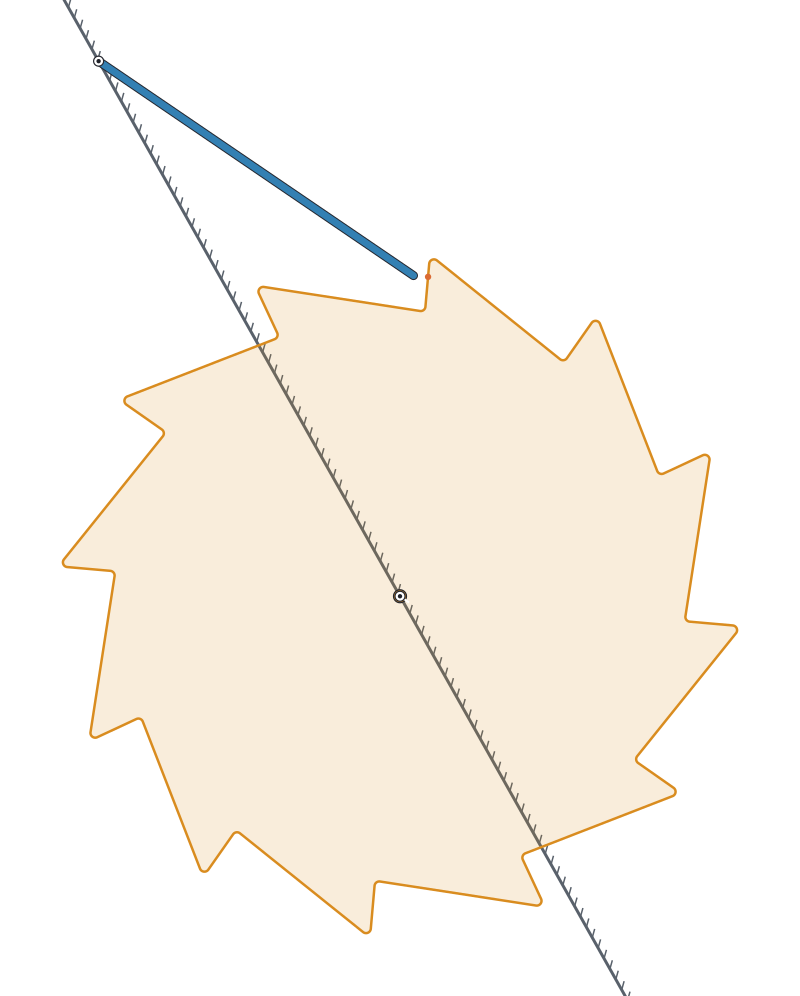
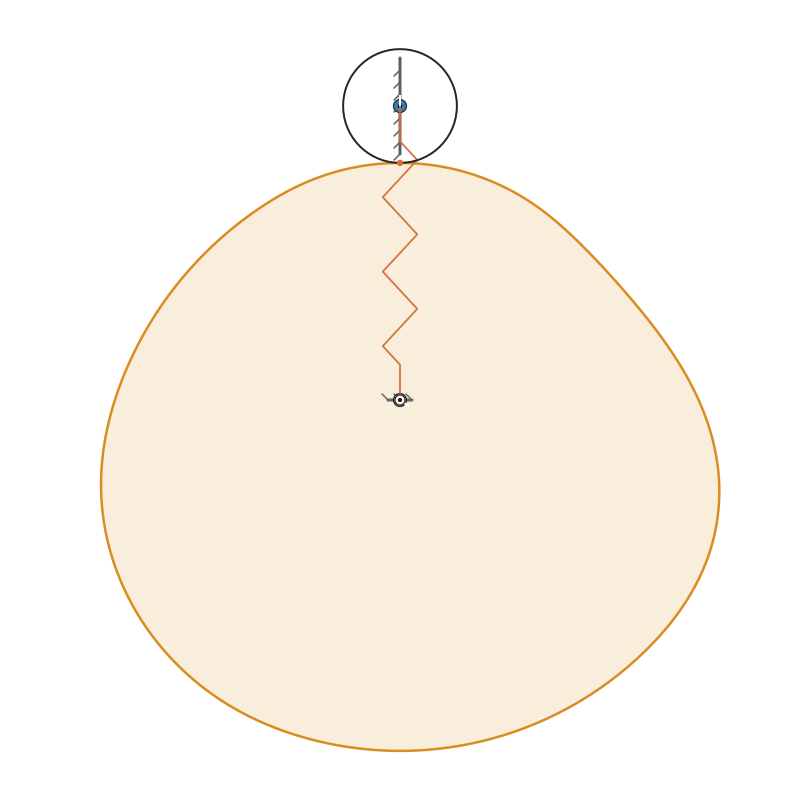
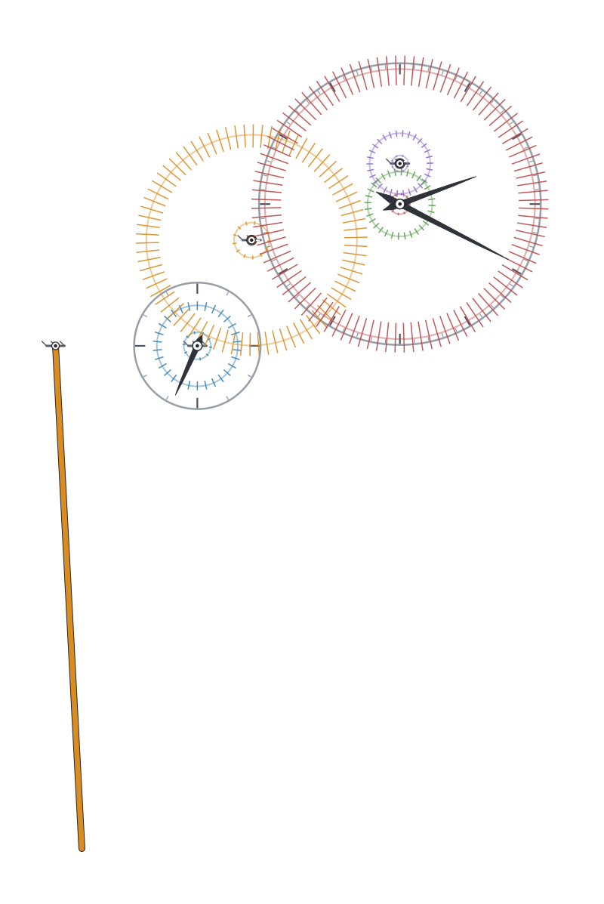
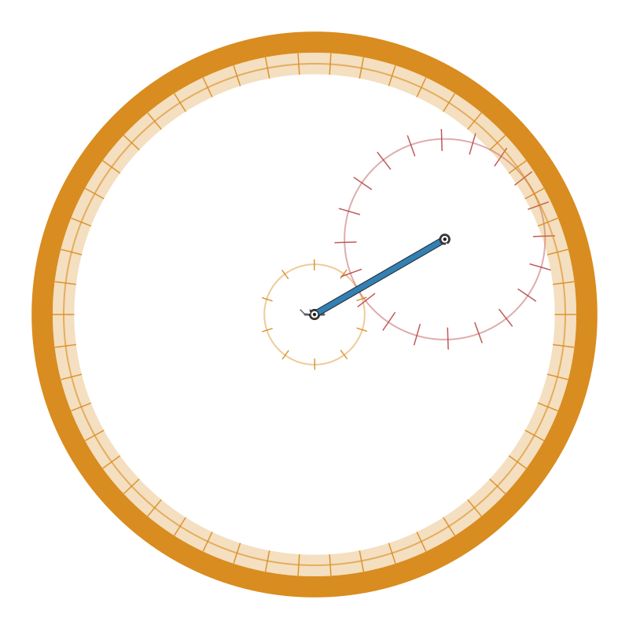
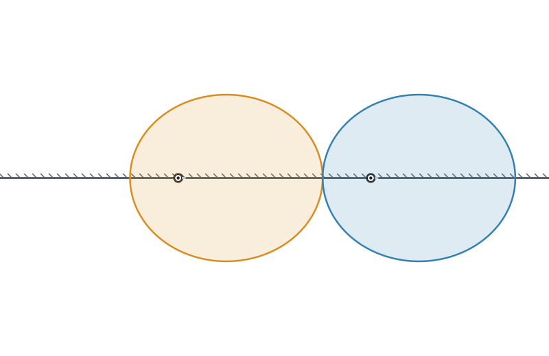
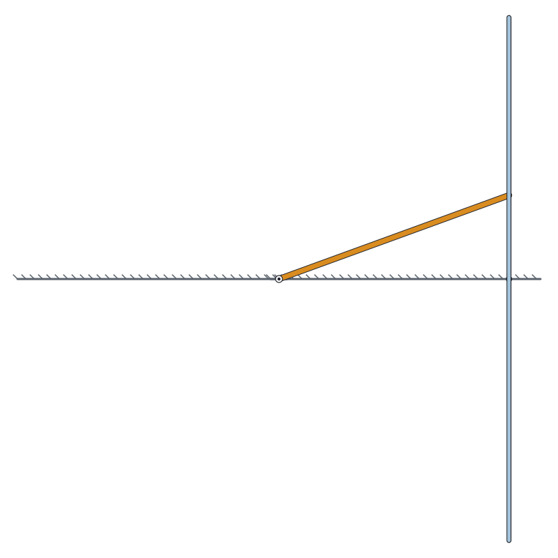
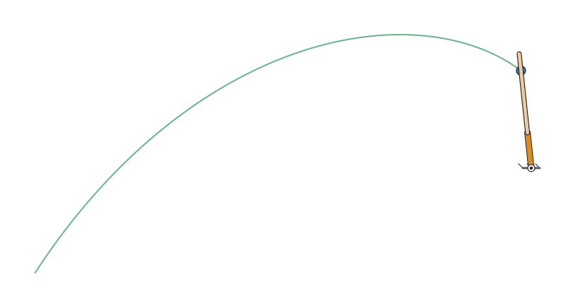

# Drawings: `mech render` (M13)

`mech render` draws a mechanism as an SVG: a single pose, or an animation that loops. It needs no
window and no OpenGL, so it works on a server, in CI, over SSH, and the result can go in a README,
a document or an email.

```bash
mech render examples/camstar.mech --at 0.4 -o camstar.svg
mech render examples/fourbar.mech --frames 48 --span 10 --speed 2 --trace coupler.B -o fourbar.svg
```

| option | meaning |
|---|---|
| `-o FILE` | the SVG to write (`-` for standard output); required |
| `--at SEC` | the time of the still, or of the first frame (default 0) |
| `--frames N` | N > 1 makes an animation: N frames spread over `--span`, looping |
| `--span SEC` | the simulated seconds an animation covers, and how far a trace runs from `--at` |
| `--speed X` | playback speed of the animation, simulated seconds per second (default 1) |
| `--trace BODY.ANCHOR` | the path of that anchor over `[at, at + span]` (a coupler curve) |
| `--width PX` | drawing width, 100 to 10000 (default 800); the height follows the mechanism |
| `--dark` | the viewer's dark colours instead of a white page |
| `--set NAME=VALUE` | replace a `param`, as everywhere else: `--set n=6` is six cams |

## What is drawn

The same things the viewer shows, in the viewer's order: dials, the ground (a hatched bar when its anchors
lie on a line, a small mark under each otherwise, and a hatched rail where a follower slides on the ground), gears
(pitch circle and a tick per tooth; a ring gear as a band), profiles (cams, ratchet wheels, ellipses: the
whole outline, filled faintly), rods as bars (a body with more than two anchors as a chain through them), shafts as hubs with
an index line, springs as coils, a rail that rides a moving body as a line from its own anchor past the guide's reach (`line.slide`, or `line.slot`
for a slot), touches
(the roller and the contact point on the curve), pins, and clock hands on top. A rail is drawn along the
follower's travel across everything shown, so an animation shows where the follower goes.

Kinematic files are re-solved from the assembly in steps of at most 1/60 s, so the branch is followed
(a four-bar does not flip). Dynamic files are integrated at their world step. A mechanism that does not
assemble, or cannot be posed at the requested time, is an error with the largest constraint residual, not a
drawing of a broken pose.

## The file

Everything is in **world coordinates**, metres with y up, inside one root transform
(`<g id="world" transform="matrix(s 0 0 -s tx ty)">`), so a number in the file is the solver's number:

* `rod` groups hold a `bar` line from anchor A to anchor B (`data-body` names the body); `shaft` groups hold a hub;
* gears are `<g class="gear" data-name>` with a `pitch` circle of the pitch radius and one `tooth` line per tooth;
* profiles are `polygon.profile` (240 points, `data-name`); touches `circle.roller` and `circle.foot`;
* springs, hands and the trace are `polyline.spring`, `polygon.hand`, `polyline.trace` (`data-anchor`);
* the root `<svg>` carries `data-mechanism` and `data-scale` (pixels per metre).

Sizes that are pixels on screen (line widths, joint hubs) are converted with the scale, so the picture is the
same at any `--width`. An animation defines each frame once in `<defs>` (`#f0`, `#f1`, ...) and a single
`<use>` cycles its `href` through them with one SMIL `<animate>`, so the file grows linearly with the frame
count: 24 to 48 frames of a small mechanism is 100 to 300 kB. Browsers play it in an `` too.

## Gallery

`scripts/make_gallery.sh` regenerates these from the examples; none is drawn by hand.

| | |
|---|---|
|  |  |
| `fourbar`, animated, with the coupler-point trace | `camstar`: four library cams, rails turned outward |
|  |  |
| `ratchet` mid-click (dynamic) | `jumpcam` at lift-off: spring, roller, contact point |
|  |  |
| `clock`: gear train, dial, hands, pendulum | `planetary`: ring, planet, sun and carrier |
|  |  |
| `ellipgears`, animated | `boom`, animated: cylinder and piston both move, tip trace |
|  |  |
| `quickreturn`, animated: the lever slot's path | `scotchyoke`, animated |
|  | |
| `slidingbead`: the bead's path as it is flung out | |

## Looking at the output

`scripts/svg2png.js` rasterizes an SVG with Chromium (Playwright), the way the drawings were checked while
they were written:

```bash
node scripts/svg2png.js out.png drawing.svg           # the first frame
node scripts/svg2png.js out.png animation.svg 1500    # whatever frame is showing after 1.5 s
```

## How it is checked

The file is read back and compared with the solver: every rod endpoint, pin, pitch circle and tooth, every
profile point (240 per curve), roller, contact point, spring end, hand tip and trace point equals the pose
`samplePoses` gives for the same time, for a kinematic four-bar, a cam on a gear, a dynamic jumping cam (against
an independent integration), the clock, a plate cam's rail, and an animation whose frame *k* is the pose at
*t<sub>k</sub>*. The transform maps everything into the page. A repeat render is identical, and so is a pose
sampled twice from the same model for every example (this found, and now pins, a bug: a model that had been
run before began its next assembly from the angle its escapement hold had pinned at the end of the last run).

## Limits

* It draws what the model contains: no dimensions, labels or force arrows, and no per-body colour choice.
* A drawing is a pose or a looped sequence of poses; it is not interactive (use `mech run` for that).
* The ground bar follows a simple rule (collinear anchors); an unusual frame may want a different symbol.
* The viewer itself still draws a bar through scattered ground anchors and two rings for a planet; the SVG
  does not, and fixing the viewer is left until it can be tested under a real OpenGL.
